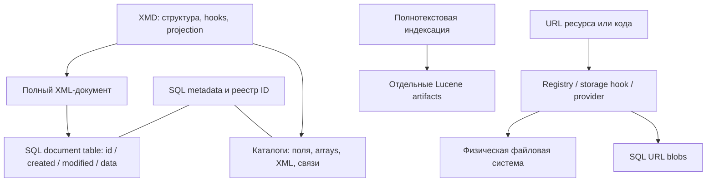

# Где находятся данные и код WebSoft HCM

При исследовании системы сначала выбрать представление: полный XML-документ,
каталог для запросов, URL-ресурс, physical file или полнотекстовый индекс.
Они связаны, но ни одно не заменяет остальные. Карта ниже основана на
[срезе Linux HCM 2025.2.1333 / PostgreSQL 16.15 от 2026-11-11](../research/platform-storage/README.md)
и ранее проверенных object/URL contracts; Windows/MSSQL/cluster не обобщены.

Стрелки показывают назначение слоёв, а не порядок вызовов, транзакции или
полностью установленный runtime pipeline.

| Задача                           | Начальная точка и существенное ограничение                                                                           |
| -------------------------------- | -------------------------------------------------------------------------------------------------------------------- |
| Найти объекты/отфильтровать поля | Зарегистрированный каталог; он может содержать проекцию, synthetic row ID, string key, SQL array и XML               |
| Прочитать/изменить объект        | Полная форма и XML-документ; неполный каталог нельзя использовать как replacement                                    |
| Понять связь                     | XMD/FOREIGN-ARRAY + фактическая SQL schema; `*_id` не гарантирует REFERENCES                                         |
| Найти форму/обработчик           | Registration, `wtv`, `qti`, `components`, `platform`, фактический loader; имя таблицы/тега не универсальный resolver |
| Найти код                        | Файлы BS/JS/XML/XMS и объекты code library/agent/template в БД; поиск по ФС охватывает лишь часть                    |
| Прочитать содержимое по URL      | Учитывать scheme, root registry, storage hook и provider; physical path и LoadUrlData могут вернуть разные bytes     |
| Разобрать отсутствие в FT-поиске | Проверить объект/каталог отдельно, затем состояние индексации; SQL GIN не равен Lucene                               |

[Карта БД](../research/platform-storage/database-layout.md) содержит 15 предметных
областей, пять служебных таблиц, примеры связок и несовпадения с документацией.
В исследованном SQL storage 414 таблиц полных XML-документов и 734 каталога;
полные documents связаны FK с общим реестром, бизнес-каталоги SQL FK между собой
не имеют. Это факт снимка, не гарантия отсутствия проверок в бизнес-коде.

[Карта файлов](../research/platform-storage/server-files.md) описывает директории,
mounts, расширения и потребителей. `.xml` может быть библиотекой, `.xms` —
исполнять бизнес-операции, `.doc` — содержать HTML с BS, `.xmi` — описывать API.
Формат, encoding и загрузчик надо устанавливать отдельно. Blobs могут содержать
XMD/XML, поэтому диск не обязательно полный источник схем и кода.

Подробнее о [документах и lifecycle](object-model.md),
[путях и SQL blobs](paths-and-storage.md), [числах/XQuery](../mcp/xquery.md).
Источники, hashes, безопасные collectors и открытые вопросы находятся в
исследовании. Первоочередной пробел — эффективная конфигурация FT: обнаружены
два разных пути индекса, но приоритет конфигов и выбранный provider не проверены.
